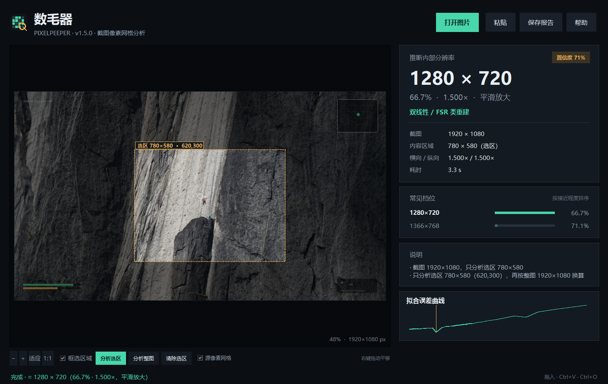
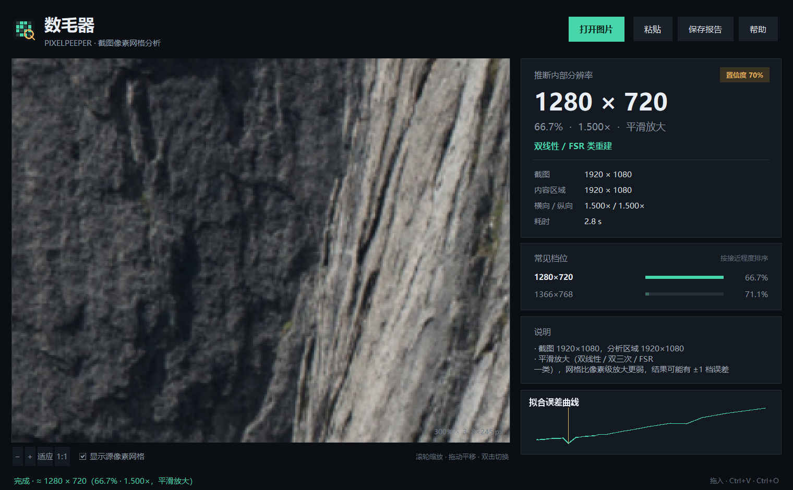
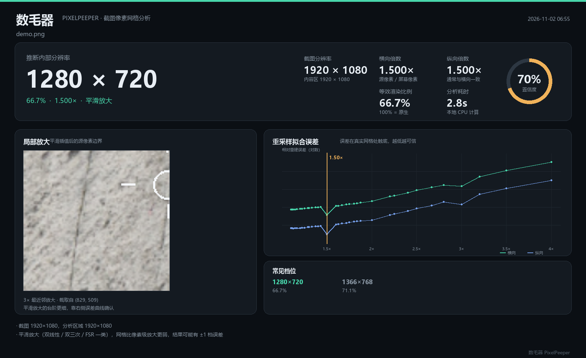

# 数毛器 · PixelPeeper

把游戏截图拖进窗口，从像素层面推断游戏真正运行在多少分辨率。

截图是按**屏幕分辨率**保存的，而游戏常常以更低的分辨率渲染，再放大到屏幕上。放大后的画面会留下可测量的网格：整列重复的像素、斜边上 1–2 px 的台阶、周期性的插值折点。这个工具就是把这些“毛”数出来。



## 怎么测得更准（推荐流程）

> **同一个游戏多截几张图，每张图都框选锯齿明显的 3D 区域，重复测几次，再取稳定的结果。**

1. **多截图**：同一游戏、同一画质设置下，截 3–5 张不同场景（白天/夜晚、近景/远景、室内/室外）。
2. **框高锯齿区**：优先选斜边、栏杆、电线、建筑轮廓、角色轮廓这类锯齿明显的 3D 区域；避开 HUD、字幕、UI、纯色天空和大面积平滑贴图。
3. **多次测量**：每张图换 2–3 个高锯齿区域分别测；同一个倍率/短边反复出现，才说明结果可信。
4. **取一致值**：多次结果落在同一档位（例如短边都在 1000–1010）时，基本可以确认；偶尔一次偏离，多半是选区里混进了 UI 或模糊背景。

《异环》实测：大量截图、多个高锯齿区域重复测量，结果稳定收敛到 **1007p（1424×1007，1.815×）**，置信度较高。

## 它能做什么

- 拖入 PNG / JPG / WebP / BMP 截图，几秒内给出**内部分辨率**、缩放倍数、等效渲染比例和置信度；
- **先框选、后分析**：导入后不自动跑，自己在画面上拖一个框，只分析 3D 区域，避开 HUD、字幕和贴图；结果仍按整图分辨率换算；
- 区分**像素级放大**（最近邻 / 整数缩放）与**平滑放大**（双线性 / 双三次 / FSR 类）；
- 支持 1.2×、1.25×、1.333×、1.5×、1.6×、1.667×、2×、3× 等非整数倍率；
- 支持**多层放大**：先拆掉截图/系统层面的 2× 像素放大，再分析逻辑帧内部的 3D 渲染倍率（例如 2× 系统放大 × 1.5× 渲染 = 3×）；
- 自动识别并裁掉黑边（letterbox / pillarbox），避开 HUD 和字幕；
- 给出最接近的常见分辨率档位，例如 `1920×1080` 截图 → `1280×720`；
- 可导出 1600×980 的**证据图**，包含局部像素放大、台阶宽度直方图 / 拟合误差曲线、分块一致性；
- 纯本地、纯 Python，不上传任何图片。

实测：一张 2584×1828 的手机游戏截图（文件其实是 JPEG 4:2:0，扩展名却叫 `.png`），被识别为 **1292×914、2.000×、91%** —— 正好是屏幕像素的一半，属于整块 2× 点对点放大。

另一个实测：同样是 2584×1828 的《异环》截图，真实网格不在 2.0×，而在 **1.815× → 1424×1007（短边约 1007）**。旧版只扫到 1.875× 和 2.0×，于是把 2.0× 谐波当成了答案（914 或 1828）。新版在 1.80×–2.05× 之间按 0.005 细扫，并用横纵一致性压掉 2.0× 谐波。

多层放大仍然支持：2× 系统放大 × 1.5× 渲染 = 3×，会拆成 861×609，而不是停在 1292×914。



分析完成后可以一键导出证据图，包含局部放大、台阶宽度直方图 / 拟合误差曲线和分块一致性：



## 快速开始（Windows）

```powershell
# 1. 安装依赖（只需要 numpy 和 pillow）
python -m pip install -r requirements.txt

# 2. 启动图形界面
python -m pixelpeeper
```

也可以双击 `start.bat`（无控制台窗口）。

使用方式：

- **拖拽**：把截图直接拖进窗口（Windows 原生 `WM_DROPFILES`，不需要额外 DnD 包）；
- **粘贴**：`Ctrl+V`，适合刚截完图；
- **打开**：点击“打开图片”或 `Ctrl+O`；载入后不会自动分析；
- 在画面上**按住左键拖一个框**，避开 HUD/字幕/UI，然后点 **“分析选区”**；也可以点“分析整图”；
- 滚轮缩放，**右键拖动平移**，双击在“适应窗口 / 200%”之间切换（框选模式下双击不缩放）；
- 勾选“源像素网格”，放大到 160% 以上即可核对青线是否贴合台阶。

确认自己跑的是新版：`python -m pixelpeeper --version` 应输出 `pixelpeeper 1.5.0`；窗口标题下方也会显示版本号。

为了保证测试有效，截图请用**系统自带截图**保存为 PNG，不要经过性能工具、聊天软件或图片编辑器的二次缩放/压缩；HiSmartPerf 之类的性能采集工具抓的图可能被工具自己缩放过，不能当作分辨率基准。

## 命令行

```powershell
python -m pixelpeeper 截图.png
python -m pixelpeeper 截图1.png 截图2.png --save-card reports
python -m pixelpeeper 截图.png --json
python -m pixelpeeper 截图.png --roi 600,300,800,600   # 只分析选区，按整图换算
python -m pixelpeeper 截图.png --quick     # 跳过逐块分析，更快
```

输出示例：

```
■ demo_game.png
  截图      1920 × 1080
  推断      ≈ 1280 × 720   66.7% · 1.500× · 平滑放大
  置信度    79%
  常见档位  1280×720 / 1366×768
  说明      截图 1920×1080，分析区域 1920×1080
  耗时      1.8s
```

## 原理

工具并行使用两个互补的检测器，最后按证据强度组合。

### 1. 重复像素检测（针对最近邻 / 整数缩放）

放大 `s` 倍时，每个源像素会占据约 `s` 个屏幕像素，因此相邻位置中约有 `1 - 1/s` 是“源像素内部”，像素值完全相同。于是

```
s = 1 / (1 - 重复位置比例)
```

实现上不直接依赖这个小数比例，而是先对一阶差分做阈值扫描，找到能让 0/1 掩码呈现**严格周期**的阈值，再把周期内“重复位置”的个数取整，用有理数 `s = P / (P - lows)` 得到精确倍率。这样 `1.5×` 会稳定得到 `3/2`，`1.2×` 得到 `6/5`，不会被噪声带偏。

### 2. 重采样拟合（针对最近邻 / 双线性 / 双三次 / FSR）

对每个候选倍率 `s` 和相位 `φ`，在 `φ + k·s` 处对画面采样，得到“源像素”序列，再分别用**最近邻**和**线性插值**重建整行画面，计算重建误差。只有真实的 `s` 能让画面几乎被完全重建，误差曲线会出现一个明显的**谷**；错误的 `s` 会损失细节，误差更高。

同时做两种核很重要：手机截图经常被保存成 JPEG，压缩噪声会破坏“完全相同的相邻像素”，但“整块复制”的最近邻重建特征仍然存在。

为了不让 HUD、字幕这些高对比度元素淹没信号，误差按行统计并丢掉最差的 30% 行，再做平均。候选倍率覆盖 1.1×–4× 的常见档位，只有“比左右邻居都低”、且绝对误差足够小的谷才会被接受。

### 3. 组合与置信度

- 两个轴都检测到严格的重复像素 → **像素级放大**，置信度 90%+；
- 两个轴的重建误差都在同一倍率处触底 → 按更保守的平滑放大报告，置信度随谷深变化；
- JPEG 破坏了重复像素、但最近邻重建仍有明显谷 → 仍可报告**像素级放大**，置信度略低；
- 没有谷、也没有重复 → **未发现网格**（可能是原生，或 DLSS/TSR 等时域重建）。

截图分辨率除以倍率就是内部分辨率；如果横纵倍率不一致，会分别计算并提示非等比缩放。

## 结果怎么看

| 显示 | 含义 |
| --- | --- |
| **像素级放大** | 最近邻 / 整数缩放，证据最强，基本可以直接相信 |
| **平滑放大** | 双线性 / 双三次 / FSR 类，可能有 ±1 档误差，优先看置信度 |
| **未发现网格** | 原生渲染，或使用了 DLSS / TSR / FSR2 等时域重建，或截图被二次压缩 |
| **置信度** | 综合轴间一致性、周期匹配度、拟合谷深；低于 55% 时建议换图复核 |
| **分块一致性** | 逐块估计的倍数热图；动态分辨率游戏会出现颜色不一致 |

## 局限

- **DLSS / TSR / FSR2** 会打散规则网格，通常只能给出“未发现网格”，这不是 bug；
- **JPEG** 会破坏“完全相同”的相邻像素；引擎会用最近邻重建兜底，但压缩太狠时置信度会下降；
- **动态分辨率**：全局结果取画面主体，逐块热图可以看到不同区域；
- **接近原生的倍率（<1.2×）**：例如 560×461 放大到 600×494（1.071×），网格只比原图粗 7%，平涂、线稿、文字多的画面很难和原生区分；工具会扫描 1.05×–1.2× 并给出低置信度结果（≤55%），必要时会显示“无法确定”而不是硬猜 2×；
- **HUD / 字幕**常常以原生分辨率绘制，工具会自动裁掉外圈 5%，但仍建议选择 HUD 较少的画面；
- 画面本身很“软”（大面积天空、景深模糊）时，平滑放大的谷会变浅，可能漏检；
- 只支持“截图 = 屏幕像素（或屏幕像素的整数倍）”的常规场景；如果截图被聊天软件二次缩放、缩放比例不是整数，网格会被破坏，结果不可靠。

## 项目结构

```
pixelpeeper/
├─ pixelpeeper/
│  ├─ analysis.py     # 检测引擎（重复像素 + 重采样拟合）
│  ├─ gui.py          # Tkinter 界面
│  ├─ dnd.py          # Windows 原生拖放（ctypes / WM_DROPFILES）
│  ├─ report.py       # 证据图渲染
│  └─ cli.py          # 命令行
├─ tests/             # 回归测试
├─ docs/              # 截图
├─ requirements.txt
├─ pyproject.toml
├─ start.bat
└─ run.pyw
```

## 测试

```powershell
python -m unittest discover -s tests -v
```

7 个单元测试覆盖：2× 最近邻、1.5× 最近邻、JPEG 压缩后的 2× 最近邻、1.5× 双线性、1.07× 近原生放大（560×461 → 600×494）、ROI 按整图换算、原生不误报。

另外用 1080p / 4K、最近邻 / 双线性 / 双三次、JPEG、HUD、黑边、照片素材做了端到端验证；低对比度、极软的画面仍可能漏检，这是方法本身的边界。

## 依赖

- Python 3.10+
- numpy
- pillow
- Tkinter（Python 官方安装包自带）

拖放使用 Windows 自带的 `WM_DROPFILES`，不依赖 `tkinterdnd2` 或任何第三方 GUI 包。
